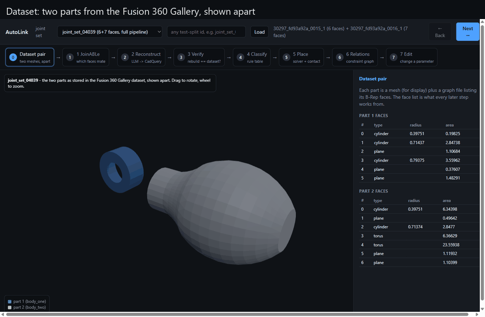

# AutoLink: from two CAD parts to a parametric, editable assembly

AutoLink takes a pair of parts from the [Fusion 360 Gallery Assembly dataset](https://github.com/AutodeskAILab/Fusion360GalleryDataset), predicts how they join with a graph neural network, rebuilds them as **parametric CadQuery models** using an LLM, infers the relations between their parameters, and lets you edit one part in the browser while the other follows.



*The full walkthrough above: dataset pair -> JoinABLe prediction -> LLM reconstruction -> verification -> joint classification -> solver placement -> inferred relations -> live edits (two parameter changes propagating to the mating part) -> a hard-set example.*

## Why

CAD assemblies are made of parts whose dimensions depend on each other (a pin's diameter and the hole it goes in), but datasets of real assemblies store only dead geometry: meshes and face lists, no parameters and no relations. AutoLink asks whether that lost design intent can be recovered automatically: *which faces mate, what parametric model would produce each part, and which parameters must stay linked when one changes.*

## The pipeline

| Step | What happens | Tool | AI? |
|---|---|---|---|
| 1 | **Which faces mate?** The two B-Rep graphs go into JoinABLe; it ranks every (face, face) pair. | [JoinABLe](https://github.com/AutodeskAILab/JoinABLe) pretrained GNN (reproduced here: **79.54 %** top-1 on the 1,926-pair test split vs 79.53 % in the paper) | GNN |
| 2 | **Rebuild each part as parametric CAD.** The face list (types, radii, centroids, normals, adjacency) is turned into a readable spec and an LLM writes a CadQuery script with named parameters. | LLM via `pipeline/llm_reconstruct.py` (Anthropic / OpenAI / Bedrock), verify-and-retry loop | LLM |
| 3 | **Verify the rebuild.** Face count and types, per-face radius/centroid matching (the *side table*), volume, bounding box, mean surface distance to the dataset mesh. Failures are fed back to step 2. | CadQuery + trimesh | no |
| 4 | **Classify the joint** from the two mating face types via a small rule table (cylinder+cylinder -> concentric, plane+plane -> flush, ...). | dict lookup | no |
| 5 | **Place the parts.** Constraints go to CadQuery's assembly solver. Where the rule leaves a slide (concentric), candidate stop positions are enumerated from shoulder faces adjacent to the mating cylinders and scored by overlap / contact. | CadQuery solver, trimesh sampling | no |
| 6 | **Infer parametric relations.** Nudge every parameter, rebuild, record which faces move (parameter -> face map); then turn the joint's radius gap into `part1.p = part2.q + c` and scan the assembled model for other coaxial equal-radius cylinders. | CadQuery, numpy | no |
| 7 | **Propagate an edit.** Change a driver parameter -> relations update the dependent part -> both rebuild -> pose re-solved -> overlap re-checked. | CadQuery | no |

Every step writes its inputs and outputs to `pipeline_demo/<joint_set>/stepN_*/` with a README, so each stage can be inspected. A longer description with the design decisions is in [`docs/METHODOLOGY.md`](docs/METHODOLOGY.md).

## Results

Twenty joint sets from the dataset's test split; full tables in [`pipeline_demo/EVALUATION.md`](pipeline_demo/EVALUATION.md), per-attempt log in [`recon/ATTEMPTS.json`](recon/ATTEMPTS.json), every run (including failures) in [`docs/experiments.md`](docs/experiments.md).

| | Easy set (10; first on disk, all axisymmetric) | Hard set (10; chosen for hole patterns, brackets, levers) |
|---|---|---|
| JoinABLe top-1 hit | 10/10 (not informative: 100 % of pairs count as correct on these parts) | **8/10** (top-10: 10/10; only 7 % of pairs acceptable) |
| Reconstruction passes step 3 | 20/20 parts, all first try | **17/18** attempted (12 first try, 1 failed after 3 tries, 2 not attempted) |
| Joint axis correct (< 1 deg) | 10/10 | **8/8** placed |
| Axial position = designer's | 4/10 | **0/8** |
| Parametric relations found | 9 | 9 |
| Edit rebuilds without interference | 10/10 | 5/8 (blind +30 % radius edits) |

How to read this: axis alignment and relation inference work on both sets. **Where to stop along the axis** is the open problem: a wheel can sit anywhere on an axle and geometry alone cannot know where the designer wanted it. That is the slot for a user-provided offset or a VLM tie-break, and it is measured rather than hidden. Reconstruction is the step that needs the most engineering (fillets, off-tangent arcs, and seam splits caused every retry).

Step 2 in these runs was performed by Claude inside a Kiro chat session acting as the LLM; the automated path in `pipeline/llm_reconstruct.py` uses the same prompt and verifier and needs an API key (below). Its retry loop was validated offline with a mock provider.

## Try it

```
webapp\run_demo.cmd           (or: conda run -n autolink-cad python webapp\server.py)   ->  http://127.0.0.1:8777
```
Pick any of the 1,926 test-split joint sets (extracted from the archive on demand), step through with Next / Back, watch steps 1 and 3-6 run live, click candidate poses at step 5, and edit parameters at step 7. The server is local-only and has no authentication.

### Setup (Windows, two conda environments)
```
conda env create -n autolink      -f environment\autolink_joinable_cpu.yml   # Python 3.7, PyTorch 1.8 CPU, PyG 1.7.2  (JoinABLe)
conda env create -n autolink-cad  -f environment\autolink_cad.yml           # Python 3.11, CadQuery 2.4, trimesh       (everything else)
conda run -n autolink-cad python pipeline\dataset_tools.py fetch            # prints the two dataset URLs; indexes the test split once the archives are in data\
```
`pysdf` must be built from source on Windows; the exact steps and every pitfall met are in [`docs/setup_windows.md`](docs/setup_windows.md). Exact package versions: `environment/lock/`.

### Run the pipeline from the command line
```
conda run -n autolink      python pipeline\joinable_predict_fast.py joint_set_04039        # step 1
set AUTOLINK_LLM_PROVIDER=anthropic   (or openai | bedrock)   + ANTHROPIC_API_KEY / OPENAI_API_KEY / AWS creds
conda run -n autolink-cad  python pipeline\llm_reconstruct.py joint_set_04039              # step 2 (+3 as verifier, up to 3 attempts)
conda run -n autolink-cad  python pipeline\pipeline_steps.py   joint_set_04039              # steps 3-7 -> pipeline_demo\joint_set_04039\
conda run -n autolink-cad  python pipeline\evaluate.py                                      # EVALUATION.md / .json over everything in pipeline_demo\
```
`--provider mock` exercises the step-2 retry loop without any API key.

## Repository layout
```
pipeline/        autolink_pipe.py (steps 3-7 library)  pipeline_steps.py  joinable_predict_fast.py (step 1, Py3.7 env)
                 llm_reconstruct.py (step 2)  verify_recon.py  dataset_tools.py  evaluate.py  joinable_notebook_offline.py
recon/           recon_<id>/part_1.py, part_2.py (parametric reconstructions)  ATTEMPTS.json
pipeline_demo/   <joint_set>/step1_... step7_...  (inputs, outputs, README per step)  EVALUATION.md  NOTICE.md
webapp/          server.py  index.html  run_demo.cmd  autolink_walkthrough.gif  screenshots/
third_party/     JoinABLe vendored at commit 5a3b9933 (MIT) with its pretrained checkpoints
docs/            METHODOLOGY.md  experiments.md  setup_windows.md  licenses.md
environment/     conda ymls + lockfiles
```

## Limitations and next steps
- Axial placement needs a tie-breaker (user offset in the UI, or a VLM shown the candidate renders).
- Reconstruction fails on sloppy sketches (off-tangent arcs) and has not been tried on NURBS or parts above ~25 faces; 2 of 20 hard-set parts were not attempted.
- Only five joint rules exist; cone/torus/plane mixes fall through.
- Blind parameter edits can create interference; a wall-thickness / clearance constraint set would make edits safe by construction.
- Two Python environments (3.7 for JoinABLe, 3.11 for CadQuery) talk through files; porting JoinABLe to a current PyTorch would remove that.

## Licences and data
Code: MIT ([`LICENSE`](LICENSE)). JoinABLe (vendored, `third_party/JoinABLe`): MIT. The Fusion 360 Gallery dataset is **not** included; it is licensed for non-commercial research only. `pipeline_demo/` holds derived artifacts (predictions, verification reports, poses, relations, face summaries) with attribution in `pipeline_demo/NOTICE.md`. Download the archives yourself using the URLs printed by `pipeline\dataset_tools.py fetch`.
